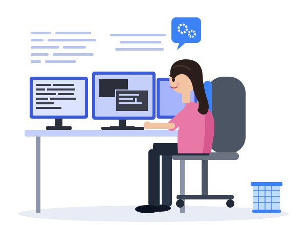

<h1 align="center">Hi 👋, I'm Sahithi Reddy</h1>
<h3 align="center">An AI Full Stack Engineer based in Boston, MA</h3>

I build AI-powered products end to end, from LLM and RAG pipelines on the backend to clean React interfaces on the front. Over 4+ years across education tech, automotive compliance and financial analytics, I've loved taking AI systems from a rough prototype all the way to production. 🤖🛠️

  

-- 🎬 I'm currently working on [**LiveMemoji Audio Lip-Sync**](https://github.com/k-sahi/LiveMemoji-audio-lipsync), which animates an avatar's lips in sync with speech audio
- 🧑‍🎤 Exploring **AI digital humans**: talking avatars, audio-driven facial animation and realistic lip movement
- 🗣️ Interested in **speech + vision AI**: text-to-speech, voice cloning, face animation and real-time avatar rendering
- 🎥 Building towards **interactive AI avatars** that can listen, think with an LLM, and talk back with natural expressions
- 👩‍💻 **4+ years** building full-stack apps across education tech, automotive compliance and financial analytics
- 🤖 I love taking **AI ideas from prototype to production**, from the model and APIs to the UI
- 🤝 I'm open to **collaborating on AI, GenAI and full-stack projects**

 

<h3 align="left">Languages and Tools:</h3>

- Languages & Backend

  

- Frontend

  

- AI, LLMs & ML

  
  
  
  
  
  
  
  
  
  
  

- Databases & Search

  
  
  
  
  

- Cloud & DevOps

  

- Tools

  

 

 <em><b>I love connecting with different people</b> so if you want to say <b>hi, I'll be happy to meet you!</b> :)</em>
